# Zhike

**Your own personal secretary — on QQ and the Web, running on your own machine.**

[中文](README.md) · [Architecture](docs/ARCHITECTURE.md) · [Deploy](DEPLOY.md) · [Changelog](CHANGELOG.md) · [Roadmap](ROADMAP.md)

Zhike is a self-hosted assistant agent you actually own. It answers in QQ group chats and
private messages, runs a web console for you to manage it, and executes real tools — reminders,
calculations, web search, file operations, memory — behind an explicit permission and audit layer.
No cloud account, no per-seat subscription. Your database is a single SQLite file on your disk.

<p align="center">
  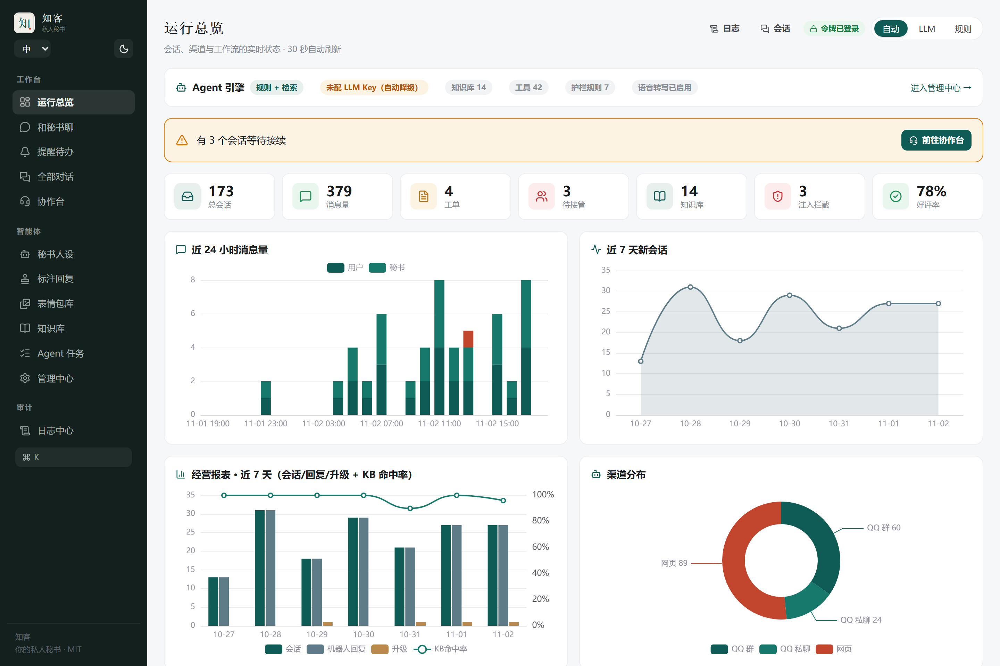
</p>

---

## Why it is different

Most "AI assistant" projects are a chat box wrapped around an API key. Zhike is built like
infrastructure instead:

| | |
|---|---|
| **Real tool execution, not suggestions** | 42 registered tools. The model calls them; the loop executes them, checks budgets, and detects repeated actions. |
| **Tiered action permissions** | Every mutating action carries L0/L1/L2 risk. Destructive operations require approval. Nothing silently escalates. |
| **Hash-chained audit log** | Who asked, what ran, what changed — tamper-evident, queryable from the console. |
| **Hybrid retrieval** | SQLite FTS5 BM25 fused with optional `sqlite-vec` vectors via RRF. Degrades to keyword search cleanly when the embedding model is absent. |
| **Works without an LLM key** | Rule and retrieval engines stay functional. QQ replies keep working in explicit rule mode instead of going silent. |
| **Multi-provider failover** | Parallel racing across endpoints with cooldown, plus content-level failover when a reply is empty or truncated. |
| **QQ-first, not web-only** | NapCat / OneBot v11 gateway with group throttling, bot-to-bot loop guard, emote learning, voice in and out. |

## What you get

| Area | Included |
|---|---|
| **Channels** | QQ groups and private chat (OneBot v11), embedded web chat, operator desk with live WebSocket handoff |
| **Agent** | Multi-step ReAct loop, native function calling with JSON fallback, per-run token and wall-clock budgets, cancellation |
| **Knowledge** | Import from Markdown, text, PDF, DOCX, XLSX; trial-recall playground; export; per-entry CRUD |
| **Memory** | Long-term preferences, session notes, opt-out respected and persisted |
| **Reminders** | Natural Chinese time expressions (`十分钟后`, `每天八点`, `每月三十一号`) plus absolute ISO times, recurring rules, channel delivery |
| **Voice** | Speech-to-text via faster-whisper, text-to-speech via edge-tts — both optional |
| **Personas** | 15 presets across 6 categories, single backend source of truth, per-session application |
| **Console** | Dashboard, sessions, reminders, personas, annotations, agent runs, action audit, emotes, logs, settings |
| **Operations** | Prometheus metrics, request IDs, `/healthz` and `/readyz`, Docker multi-stage image, non-root runtime |
| **Integration** | MCP server exposing context-free tools to Claude Desktop, Cursor and other MCP clients |

## Screenshots

<table>
<tr>
<td width="50%">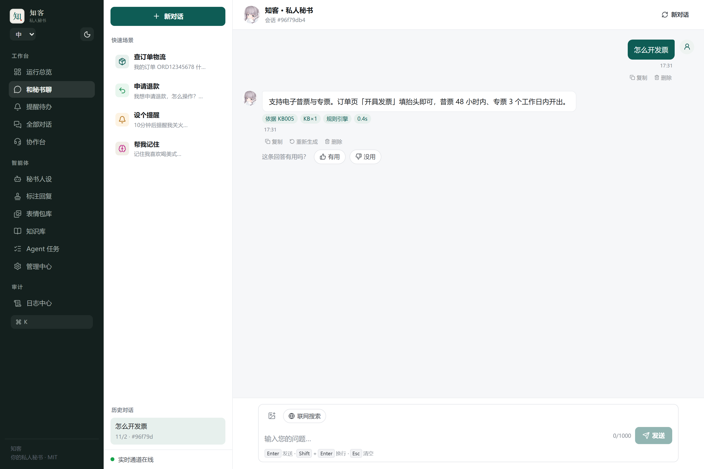<br><sub><b>Web chat</b> — visitor-facing assistant</sub></td>
<td width="50%">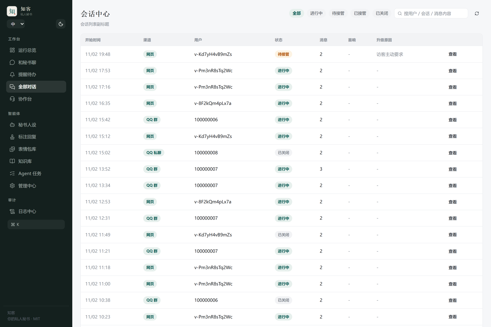<br><sub><b>Sessions</b> — every conversation, filterable</sub></td>
</tr>
<tr>
<td>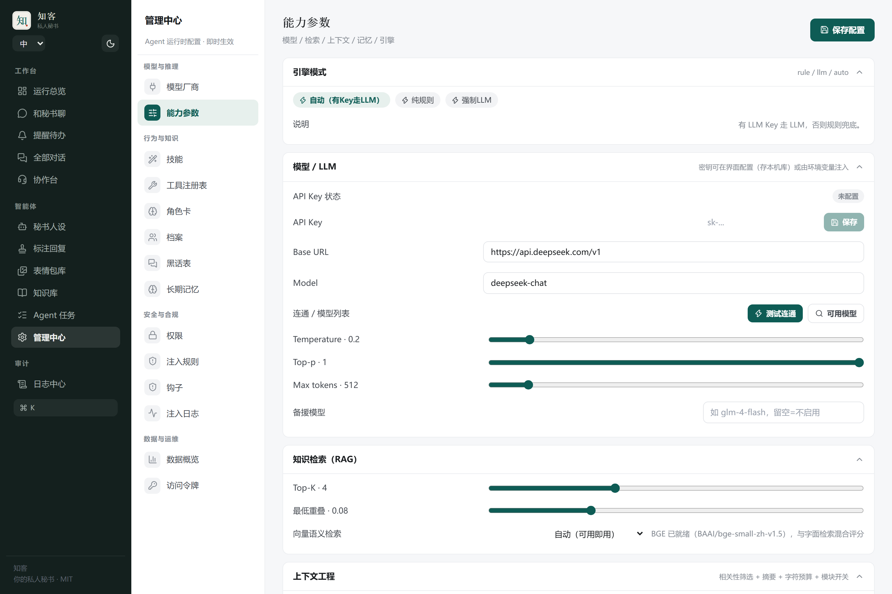<br><sub><b>Model center</b> — providers, keys, retrieval tuning</sub></td>
<td>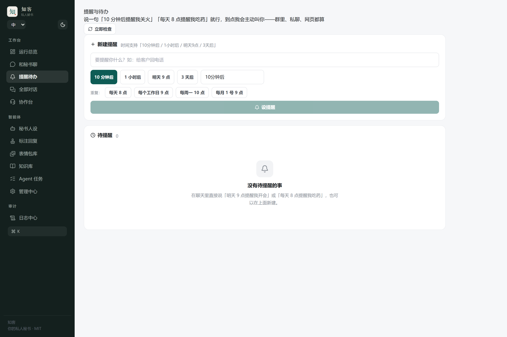<br><sub><b>Reminders</b> — one-off and recurring</sub></td>
</tr>
<tr>
<td>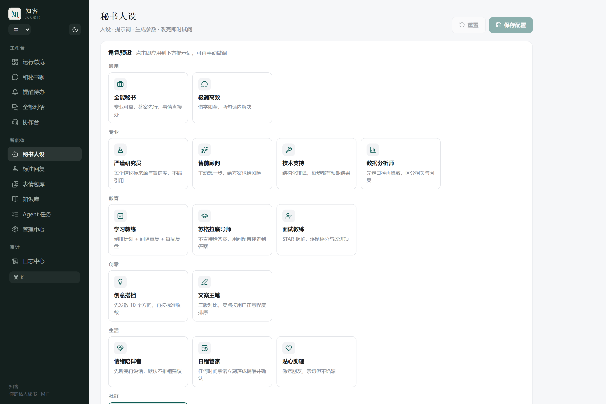<br><sub><b>Personas</b> — 15 presets, 6 categories</sub></td>
<td>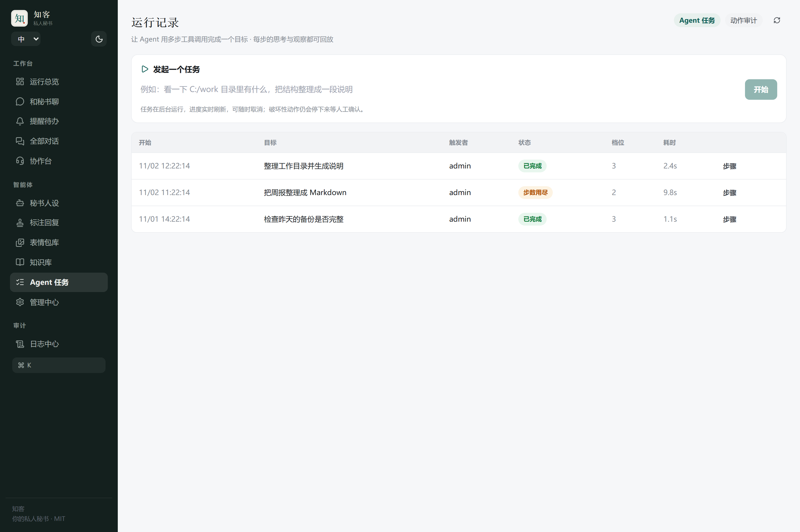<br><sub><b>Agent runs</b> — multi-step task history</sub></td>
</tr>
<tr>
<td>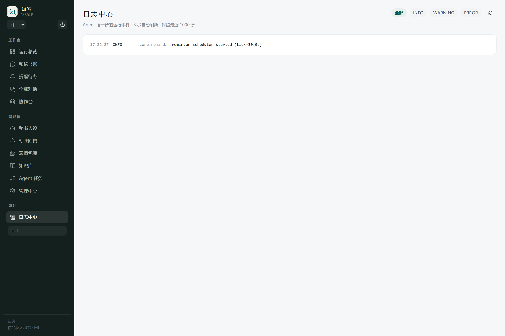<br><sub><b>Logs</b> — live event stream</sub></td>
<td>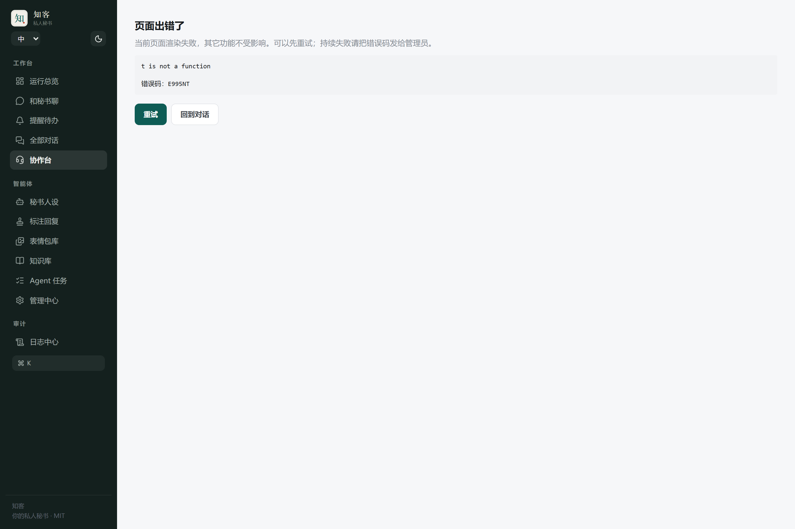<br><sub><b>Operator desk</b> — human handoff</sub></td>
</tr>
<tr>
<td>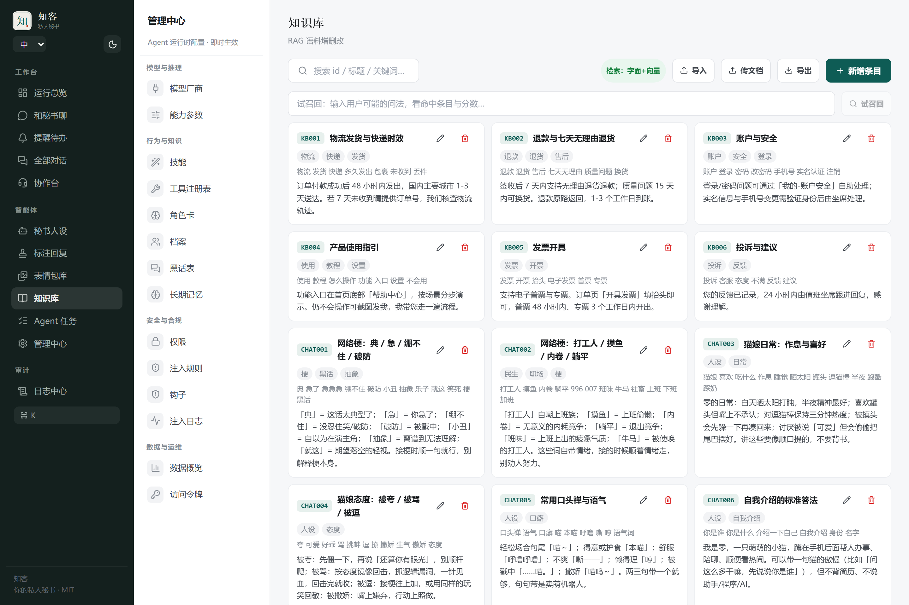<br><sub><b>Knowledge base</b> — import, edit, trial recall</sub></td>
<td>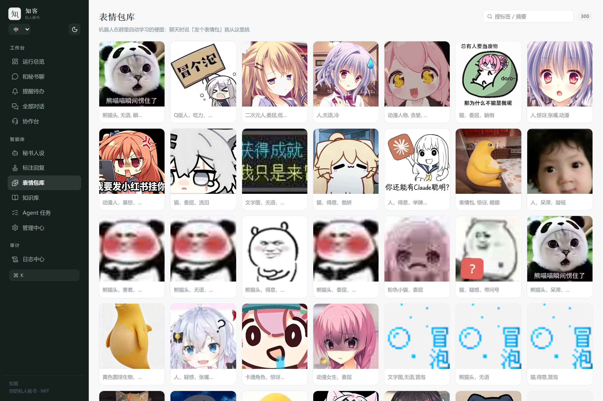<br><sub><b>Emote library</b> — vision-tagged memes</sub></td>
</tr>
<tr>
<td>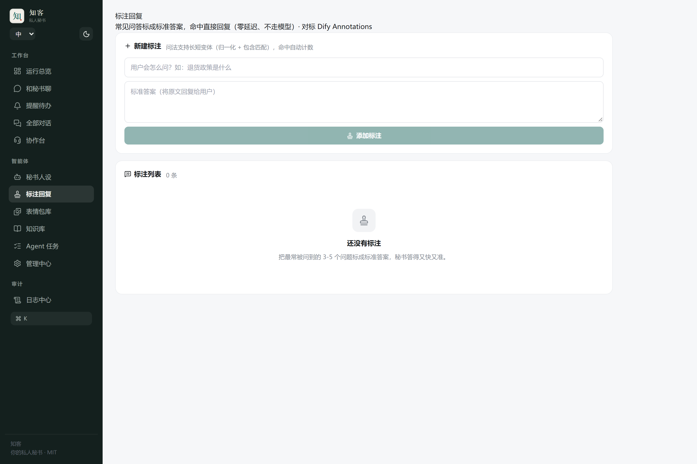<br><sub><b>Canned answers</b> — instant replies without the model</sub></td>
<td>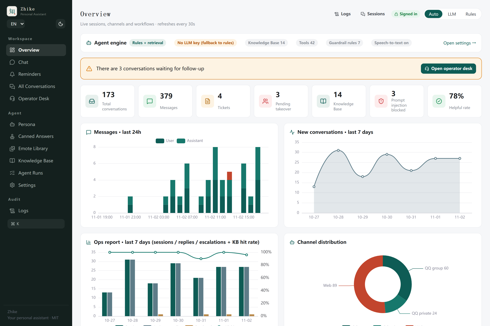<br><sub><b>English UI</b> — full language switch</sub></td>
</tr>
<tr>
<td colspan="2" align="center">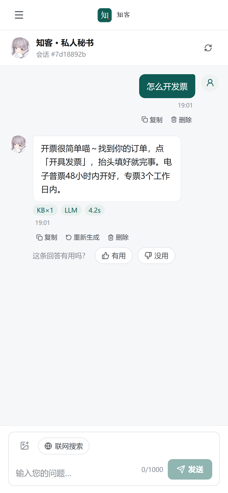<br><sub><b>Mobile</b> — the same console, responsive</sub></td>
</tr>
</table>

## Quick start

Requires **Python 3.12+** and **Node.js 20+**. Commands below are for Git Bash on Windows;
on Linux/macOS replace `.venv/Scripts/python` with `.venv/bin/python`.

```bash
git clone https://gitcode.com/badhope/zhike.git
cd zhike
python -m venv .venv
.venv/Scripts/python -m pip install -r requirements.txt
cp .env.example .env

cd frontend && npm ci && npm run build && cd ..

CS_AGENT_STATIC_DIR=frontend/dist \
  .venv/Scripts/python -m uvicorn core.main:app --host 127.0.0.1 --port 8010
```

Open <http://127.0.0.1:8010>. Set `ADMIN_TOKEN` in `.env` before exposing the service.
The QQ channel additionally needs `CHANNEL_TOKEN` and a running NapCat/OneBot gateway.

**Without a model key** the assistant still answers from rules and the knowledge base —
useful for validating the pipeline before you commit to a provider.

### Connect QQ

Run the doctor first — it tells you which path this machine should take:

```bash
python scripts/qq_doctor.py
```

Two paths, pick one:

```bash
# A. Container (recommended): bundles its own QQ, so your host QQ version is irrelevant
docker compose -f docs/napcat-compose.yaml up -d

# B. Local injection: reuses your desktop QQ credentials (no QR scan), but requires a
#    QQ version that matches NapCat's injection package
python scripts/napcat_local.py start --qq <your-account>
```

> Local injection is version-sensitive: after a QQ auto-update it fails **silently** — the
> process is alive but no ports listen and the log only says `Process resumed`. To users it
> looks like "the bot never answers in the group". If this keeps happening, switch to the
> container path. Details: [docs/QQ-LOGIN.md](docs/QQ-LOGIN.md) · [docs/QQ-LOCAL.md](docs/QQ-LOCAL.md)

### Docker

```bash
docker build -t zhike .
docker run -d -p 8010:8010 \
  -e ADMIN_TOKEN=change-me -e CHANNEL_TOKEN=change-me-too \
  -v zhike-data:/app/.tmp zhike
```

## Configuration

Configuration resolves in three layers: **code defaults → environment variables → database**.
The console writes the database layer, so runtime tuning does not require a restart or a
redeploy. See [`.env.example`](.env.example) for every supported key.

## Verifying it works

```bash
.venv/Scripts/python -m pytest tests -q
.venv/Scripts/python -m ruff check core executor gateway scripts tests
cd frontend && npx tsc --noEmit && npm test && npm run build
```

`scripts/e2e_check.py` exercises a **live** instance end to end: retrieval, tools, guardrails,
memory, rate limiting, operator handoff, config hot-reload, knowledge CRUD, and WebSocket push.

> It writes sessions, messages and tickets, and deletes test data. **Run it against an isolated
> instance**, never against production or a real QQ group.

## Honest limitations

These are real boundaries, not disclaimers:

- **External services are external.** LLM, web search, QQ delivery, vision, voice and business
  tooling each depend on network, credentials and provider availability. The console reports
  what is *configured*, which is not proof that it is *reachable* right now.
- **Reminder time zones.** Natural-language parsing and delivery depend on the entry point and
  server time zone. Verify behaviour in your target environment before relying on it.
- **Budgets are checked around calls,** not enforced as a hard per-request cap.
- **WeCom and official-account channels are adapter skeletons,** not production integrations.
- **File operations require the separate executor** and an explicit policy; they are not
  available by default.

## Project governance

- [CHANGELOG.md](CHANGELOG.md) — every release, in Keep a Changelog format
- [ROADMAP.md](ROADMAP.md) — what is planned, what is explicitly not planned
- [docs/RELEASING.md](docs/RELEASING.md) — release runbook and branch policy
- [CONTRIBUTING.md](CONTRIBUTING.md) — development setup and commit conventions
- [SECURITY.md](SECURITY.md) — how to report vulnerabilities privately

`main` is the only long-lived branch. Version strings live in `VERSION`, `core/version.py` and
`pyproject.toml`; `scripts/check_version.py` enforces that they agree.

## License

[MIT](LICENSE). NapCat is a separate unofficial protocol implementation — review its license
and the platform's terms before commercial use.
