# 知客 Zhike

**你自己的私人秘书 —— 跑在 QQ 和网页上，也跑在你自己的机器上。**

[English](README.en.md) · [架构说明](docs/ARCHITECTURE.md) · [部署手册](DEPLOY.md) · [更新日志](CHANGELOG.md) · [路线图](ROADMAP.md)

知客是一个真正属于你的自托管助手。它在 QQ 群聊和私聊里回话，提供一个网页控制台供你管理，
并且会真的去执行工具——设提醒、算数、联网搜索、读写文件、记事情——每一步都走明确的权限与审计层。
没有云端账号，没有按人头订阅，整个数据库就是你磁盘上的一个 SQLite 文件。

<p align="center">
  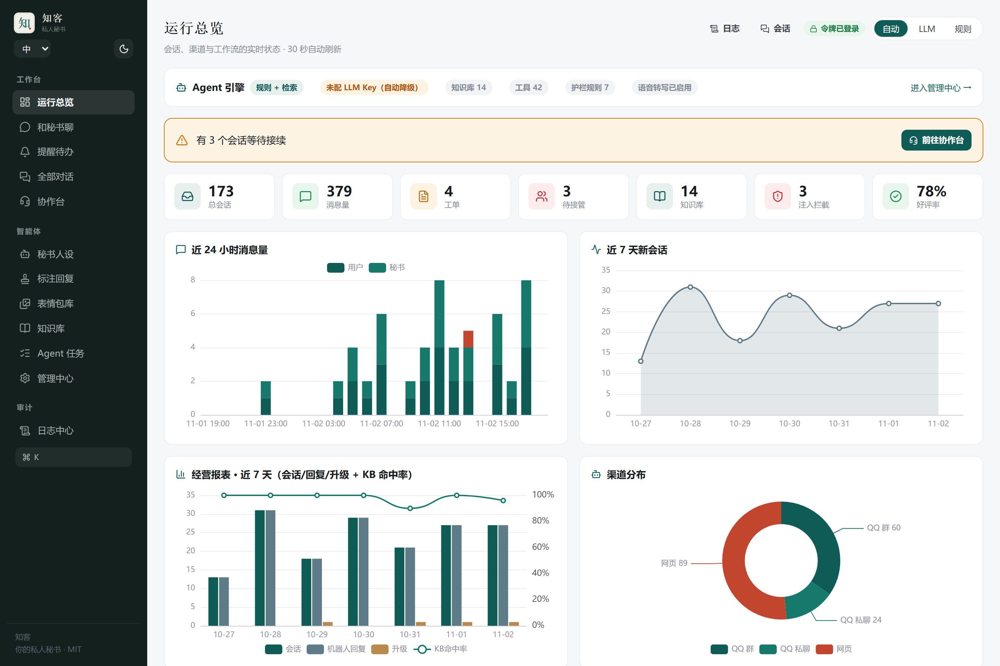
</p>

---

## 它和别的项目不一样的地方

多数「AI 助手」项目只是给 API Key 套了个聊天框。知客是按基础设施的思路做的：

| | |
|---|---|
| **真执行，不是给建议** | 42 个已注册工具。模型负责选，循环负责执行、核对预算、检测重复动作。 |
| **分级动作权限** | 每个写操作都带 L0/L1/L2 风险级别，破坏性动作必须走审批，不存在悄悄升级。 |
| **哈希链审计** | 谁提的、跑了什么、改了什么，防篡改、可查询。 |
| **混合检索** | SQLite FTS5 BM25 与可选的 `sqlite-vec` 向量经 RRF 融合；没有向量模型时干净降级为关键词检索。 |
| **没有模型 Key 也能用** | 规则引擎与检索照常工作。QQ 在显式规则模式下正常回复，而不是静默不回。 |
| **多厂商备援** | 多端点并行竞速 + 冷却熔断，另有内容级备援：回复为空或被截断时自动换模型。 |
| **QQ 优先，不是只管网页** | NapCat / OneBot v11 网关，带群节流、机器人对机器人循环护栏、表情包学习、语音收发。 |

## 能力清单

| 方面 | 已包含 |
|---|---|
| **渠道** | QQ 群聊与私聊（OneBot v11）、内嵌网页对话、坐席工作台（WebSocket 实时接管） |
| **Agent** | 多步 ReAct 循环、原生 function calling 与 JSON 降级、单次运行 token 与耗时预算、可取消 |
| **知识库** | 支持 Markdown / 文本 / PDF / DOCX / XLSX 导入、试召回、导出、逐条增删改 |
| **记忆** | 长期偏好、会话笔记；用户要求不记时尊重并持久化该选择 |
| **提醒** | 中文自然时间（`十分钟后`、`每天八点`、`每月三十一号`）与绝对 ISO 时间、周期规则、渠道投递 |
| **语音** | faster-whisper 语音转写、edge-tts 语音合成，均为可选 |
| **人设** | 6 大类共 15 个预设，每个带结构化角色卡（设定事实/叙述/语料/未知策略），回复过角色一致性守卫 |
| **控制台** | 运行总览、会话、提醒、人设、标注回复、Agent 任务、动作审计、表情包、日志、管理中心 |
| **运维** | Prometheus 指标、请求 ID、`/healthz` 与 `/readyz`、多阶段 Docker 镜像、非 root 运行 |
| **集成** | MCP 服务端，把无上下文依赖的工具暴露给 Claude Desktop、Cursor 等 MCP 客户端 |

## 界面截图

<table>
<tr>
<td width="50%">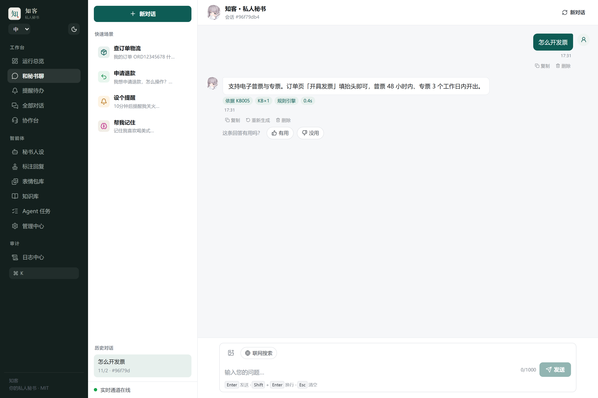<br><sub><b>网页对话</b> — 访客侧助手</sub></td>
<td width="50%">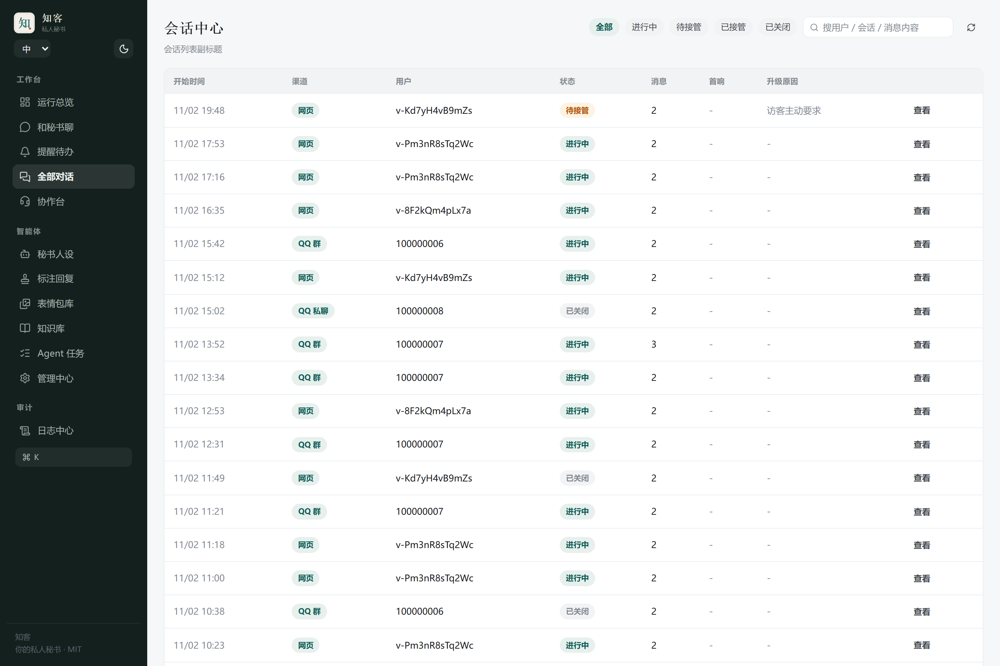<br><sub><b>会话中心</b> — 全部对话，可筛选</sub></td>
</tr>
<tr>
<td>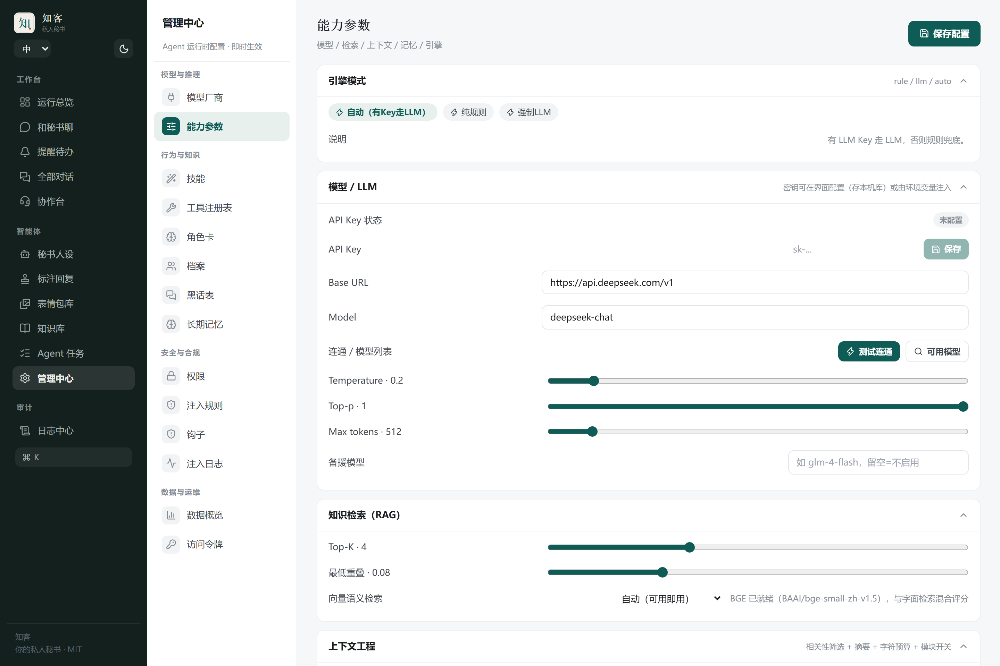<br><sub><b>模型中心</b> — 厂商、密钥、检索调参</sub></td>
<td>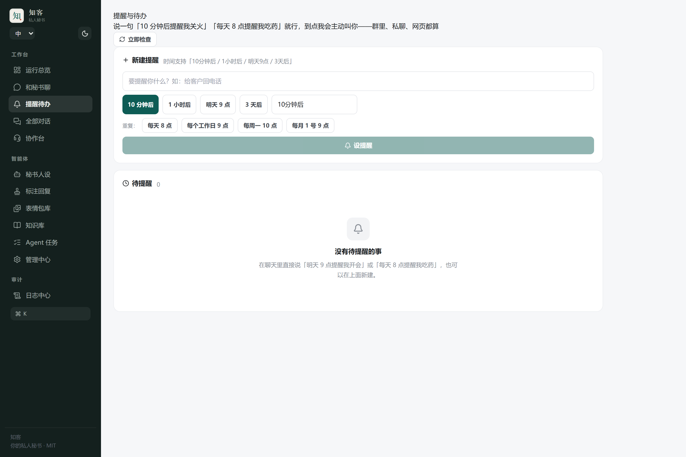<br><sub><b>提醒待办</b> — 一次性与周期</sub></td>
</tr>
<tr>
<td>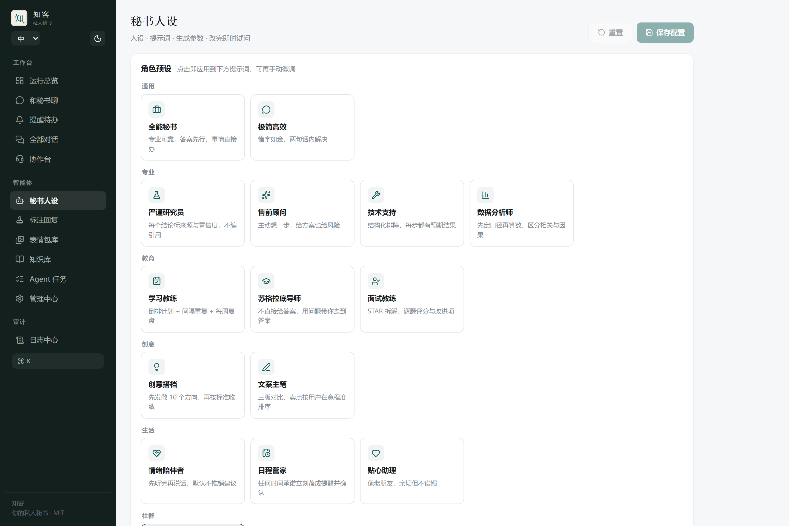<br><sub><b>秘书人设</b> — 15 个预设，6 大类</sub></td>
<td>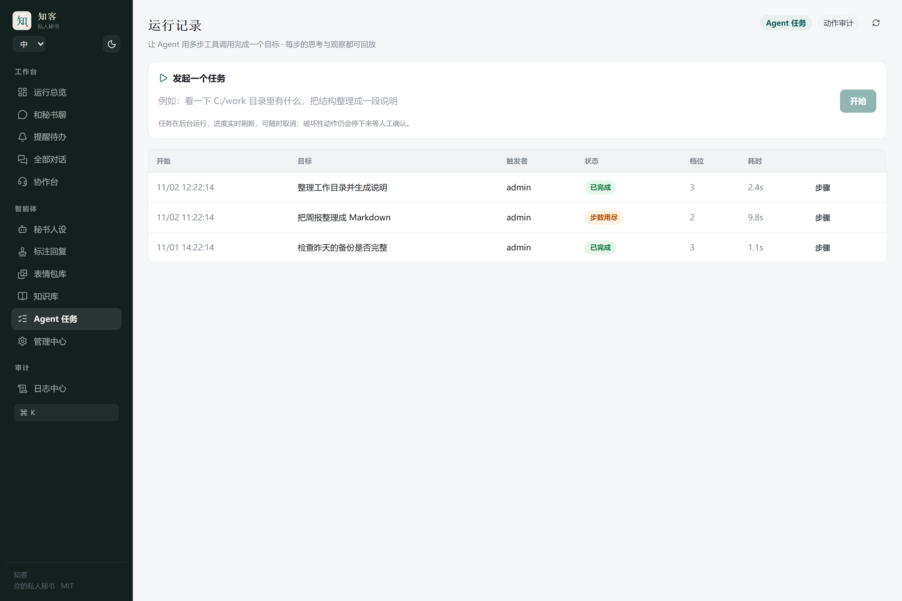<br><sub><b>Agent 任务</b> — 多步任务历史</sub></td>
</tr>
<tr>
<td>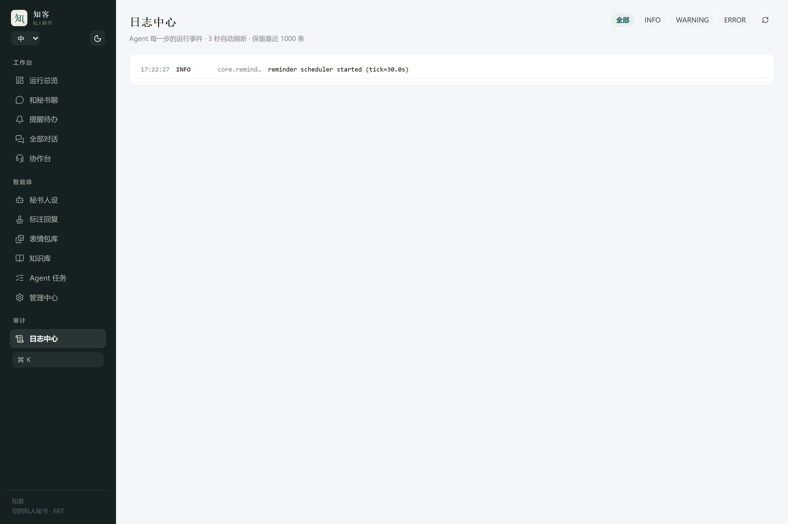<br><sub><b>日志中心</b> — 实时事件流</sub></td>
<td>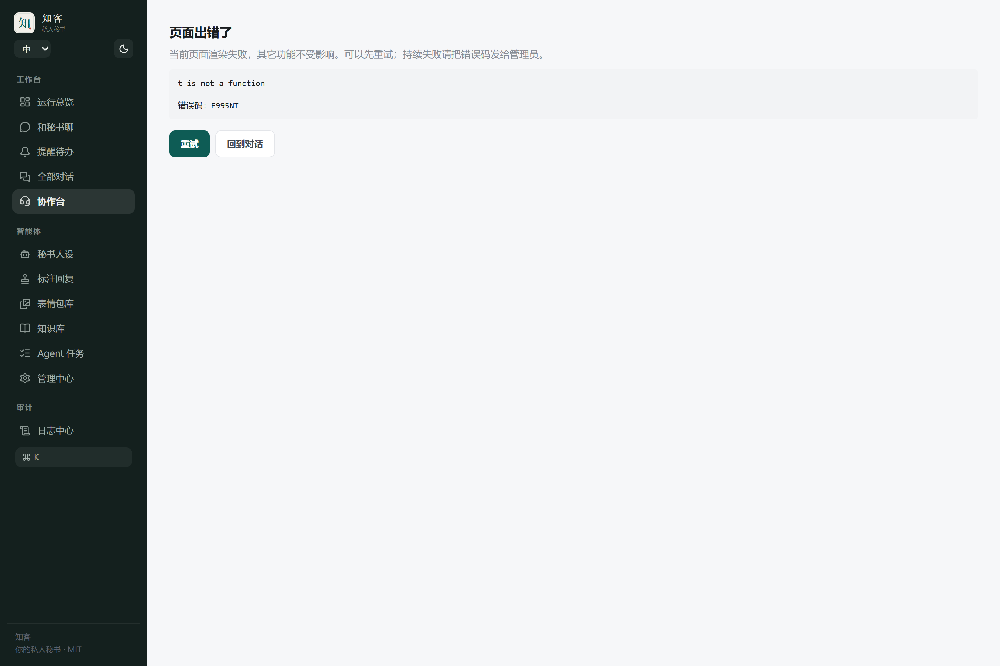<br><sub><b>坐席工作台</b> — 人工接管</sub></td>
</tr>
<tr>
<td>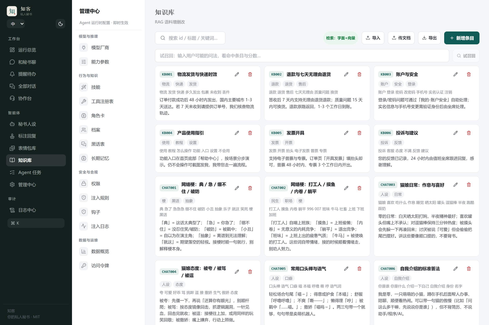<br><sub><b>知识库</b> — 导入、编辑、试召回</sub></td>
<td>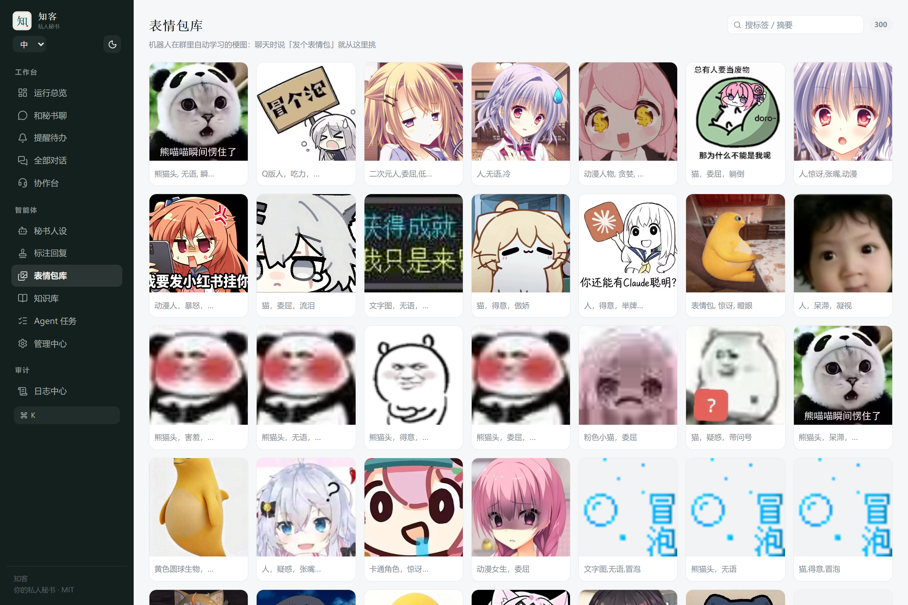<br><sub><b>表情包库</b> — 视觉打标的梗图</sub></td>
</tr>
<tr>
<td>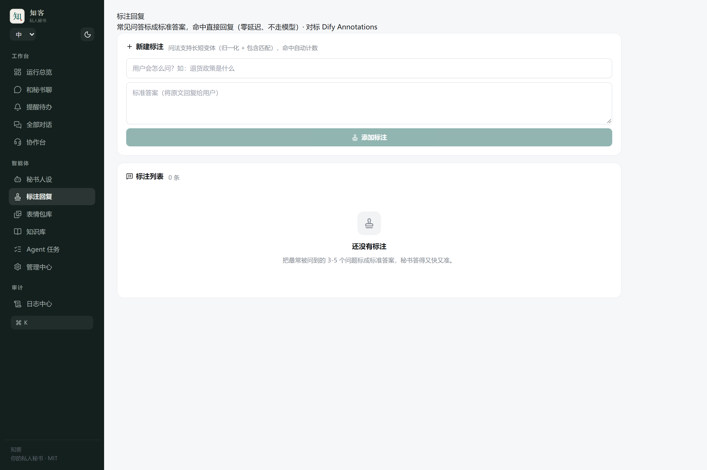<br><sub><b>标注回复</b> — 不经过模型的标准答案</sub></td>
<td>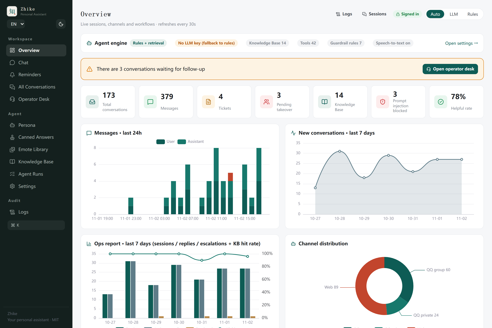<br><sub><b>英文界面</b> — 全站语言切换</sub></td>
</tr>
<tr>
<td colspan="2" align="center">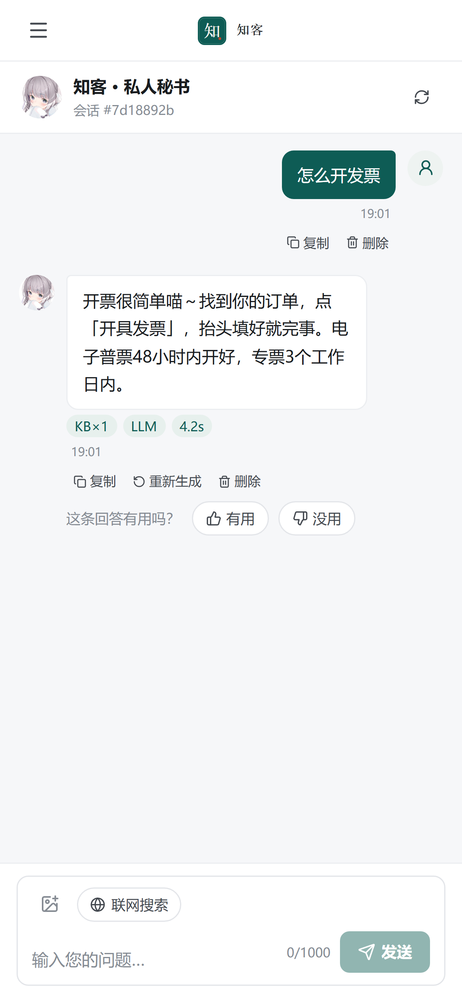<br><sub><b>移动端</b> — 同一套控制台，自适应</sub></td>
</tr>
</table>

## 快速开始

需要 **Python 3.12+** 与 **Node.js 20+**。以下命令适用于 Windows 的 Git Bash；
Linux/macOS 请把 `.venv/Scripts/python` 换成 `.venv/bin/python`。

```bash
git clone https://gitcode.com/badhope/zhike.git
cd zhike
python -m venv .venv
.venv/Scripts/python -m pip install -r requirements.txt
cp .env.example .env

cd frontend && npm ci && npm run build && cd ..

CS_AGENT_STATIC_DIR=frontend/dist \
  .venv/Scripts/python -m uvicorn core.main:app --host 127.0.0.1 --port 8010
```

打开 <http://127.0.0.1:8010>。对外暴露前务必在 `.env` 里设置 `ADMIN_TOKEN`。
QQ 渠道还需要 `CHANNEL_TOKEN` 以及运行中的 NapCat/OneBot 网关。

**没有模型 Key 时**，助手仍会依据规则与知识库作答——可以先验证整条链路，再决定接哪家厂商。

### 接入 QQ

先跑一次自检，它会判断你这台机器该走哪条路：

```bash
python scripts/qq_doctor.py
```

两条路径，选一条：

```bash
# A. 容器版（推荐）：容器自带 QQ，宿主机的 QQ 版本与你无关，首次扫码一次
docker compose -f docs/napcat-compose.yaml up -d

# B. 本机注入：复用桌面 QQ 的登录凭据，免扫码，但要求 QQ 版本与 NapCat 匹配
python scripts/napcat_local.py start --qq <你的账号>
```

> 本机注入对 QQ 版本敏感：QQ 自动升级后注入会**静默失效**（进程在但端口全不通、
> 日志只写 `Process resumed`），表现就是「群里一直没人回」。反复遇到就换容器版。
> 排障细节见 [docs/QQ-LOGIN.md](docs/QQ-LOGIN.md) 与 [docs/QQ-LOCAL.md](docs/QQ-LOCAL.md)。

### Docker

```bash
docker build -t zhike .
docker run -d -p 8010:8010 \
  -e ADMIN_TOKEN=change-me -e CHANNEL_TOKEN=change-me-too \
  -v zhike-data:/app/.tmp zhike
```

## 配置

配置分三层解析：**代码默认值 → 环境变量 → 数据库**。控制台写的是数据库层，
所以运行时调参不需要重启或重新部署。全部支持的键见 [`.env.example`](.env.example)。

## 验证它真的能用

```bash
.venv/Scripts/python -m pytest tests -q
.venv/Scripts/python -m ruff check core executor gateway scripts tests
cd frontend && npx tsc --noEmit && npm test && npm run build
```

`scripts/e2e_check.py` 会对**运行中的实例**做端到端体检：检索、工具、护栏、记忆、限流、
人工接管、配置热更新、知识库增删改、WebSocket 推送。

> 它会写入会话、消息与工单，并删除测试数据。**只能对隔离实例运行**，
> 不要指向生产库或真实 QQ 群。

## 诚实的限制

这些是真实的边界，不是免责声明：

- **外部服务就是外部的。** 模型、联网搜索、QQ 投递、视觉、语音与业务工具都依赖网络、凭据与
  厂商可用性。控制台报告的是「已配置」，不等于「此刻可达」。
- **提醒时区。** 自然语言解析与投递取决于入口与服务器时区，依赖前请在目标环境验证。
- **预算是在调用前后核对的**，不是单次请求的硬性上限。
- **企业微信与公众号渠道是适配骨架**，不是可直接上生产的接入。
- **文件操作需要单独的执行器**与显式策略，默认不可用。

## 项目管理

- [CHANGELOG.md](CHANGELOG.md) — 每个版本的变更，遵循 Keep a Changelog 格式
- [ROADMAP.md](ROADMAP.md) — 计划做什么，以及明确不做什么
- [docs/RELEASING.md](docs/RELEASING.md) — 发布流程与分支策略
- [CONTRIBUTING.md](CONTRIBUTING.md) — 开发环境与提交规范
- [SECURITY.md](SECURITY.md) — 私下报告安全问题的方式

`main` 是唯一长期分支。版本号存在于 `VERSION`、`core/version.py` 与 `pyproject.toml`，
由 `scripts/check_version.py` 强制保持一致。

## 许可

[MIT](LICENSE)。NapCat 是独立的非官方协议端实现，商用前请自行确认其许可与平台规则。
