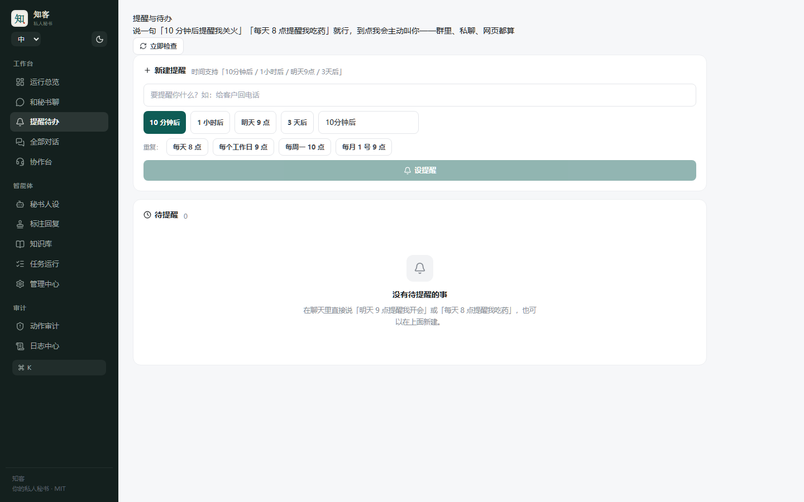
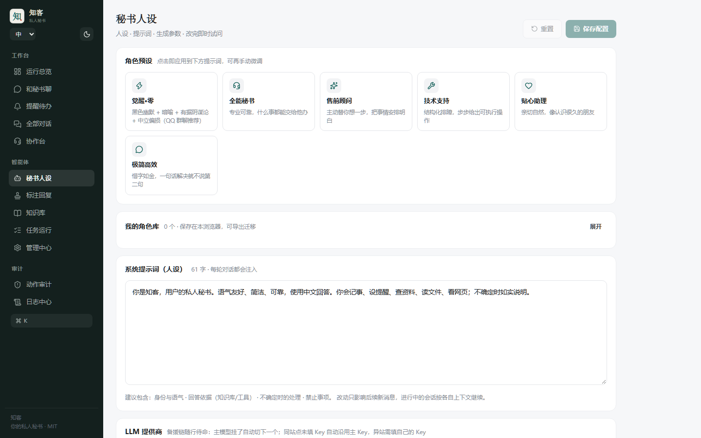
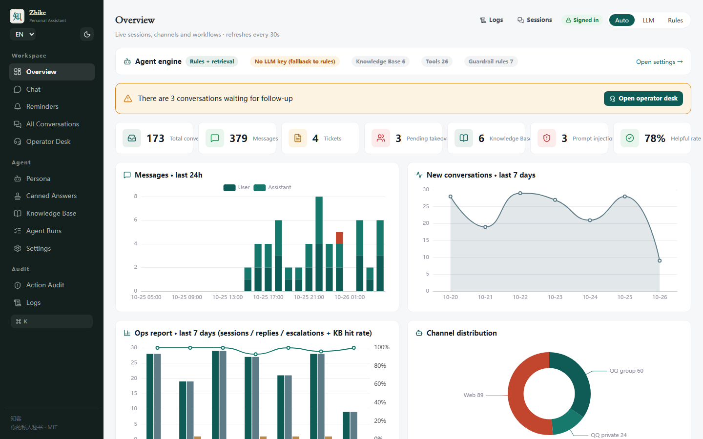
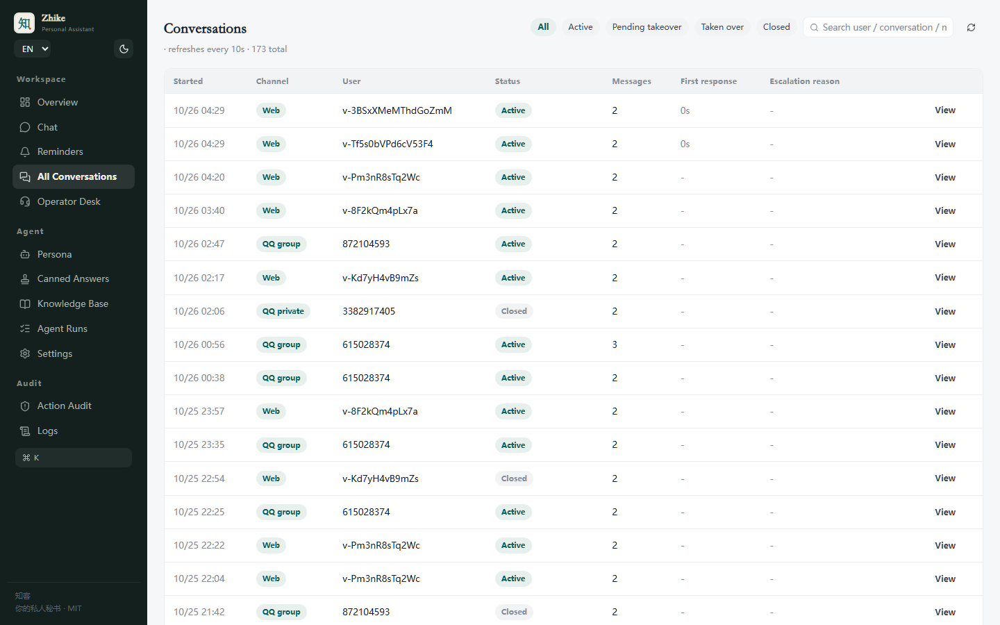

# 知客 Zhike · 你的私人秘书 / Your Personal Assistant

<div align="center">

[中文](#中文) · [English](#english)


</div>

---

## 中文

**可自托管的个人助理 Agent 底座**：QQ 群/私聊 + Web 双渠道，内置 ReAct 工具循环、原生 function calling、混合检索（FTS5 + 向量 RRF）、长期记忆、提醒调度、动作权限分级与全链路审计。自带猫娘人格「零」：毒舌、有立场、政治话题打太极。MIT 开源。

### 核心设计

| 部件 | 实现 | 依据的成熟方案 |
|---|---|---|
| 工具调用 | OpenAI function calling（`tools` + `tool_calls`），端点不支持时自动退 JSON | OpenAI API 规范 |
| 工具暴露 | MCP server（`core/mcp_server.py`），任意 MCP 客户端可调用 | Model Context Protocol |
| 多步执行 | ReAct 循环 PLAN → ACT → OBSERVE，步数/工具/Token/墙钟/费用预算 + 死循环检测 | ReAct + Agent SDK 预算范式 |
| 检索 | SQLite FTS5 BM25 + 可选 BGE 向量，RRF 融合；索引故障退字面兜底 | BM25 / RRF |
| 可观测 | OpenTelemetry GenAI span（可选）+ 指标 + 结构化事件日志（默认落 `logs/app.log`，8MB 轮转） | OTel GenAI semantic conventions |
| 结构化输出 | Pydantic 校验 + 逐字段宽松兜底 | PydanticAI / Agents SDK |
| 权限 | L0 只读 / L1 可逆写 / L2 破坏性（强制审批）× T0–T3 自主度 | 最小权限 + 审批闸门 |
| 审计 | 动作/审批/配置变更写 SHA-256 哈希链，控制台可校验 | 追加式审计链 |

### 功能

- **对话**：SSE 流式、图片多模态、Markdown、停止生成、重新生成、逐条删除
- **42 个内置工具**：看/生/发图、发语音（TTS）、联网搜索、读网页、读文档（PDF/DOCX/XLSX）、算数、时间、长期记忆、提醒、群记录/群成员/好友、主动发消息、戳一戳/表情回应/群精华/合并转发、群管理（禁言/改名片/改群名/公告/传文件/撤回/入群与好友审批）
- **提醒待办**：`10 分钟后`/`明天 9 点`/`每天 8 点`/`每个工作日 9 点`，按本地时区调度并推回原渠道
- **RAG 知识库**：Markdown/PDF/Word/Excel 导入、分块、试召回、标注回复（命中即秒回）
- **协作台**：待接管队列、内部备注、快捷话术、SLA 首响计时、答案回流知识库
- **中英双语**：侧栏切换 `中 / EN`，界面框架全量翻译；业务数据保持原语言
- **QQ 全量接管**：收到 face/mface 表情转成可读标记、群里回帖带引用、用户与群自动建档、群黑话自动沉淀、视觉模型独立配置（u2-med 实测可看图）
- **渠道**：QQ（NapCat + OneBot v11 + NoneBot2 网关）、Web；企业微信/公众号适配骨架

### 镜像仓库

同一套代码同步到五个公开仓库（任选其一获取，内容一致）：

- GitHub：[badhope/zhike](https://github.com/badhope/zhike) · [X33834/zhike](https://github.com/X33834/zhike) · [Morningstar202604/zhike](https://github.com/Morningstar202604/zhike)
- Gitee：[badhope/zhike](https://gitee.com/badhope/zhike)
- GitCode：[badhope/zhike](https://gitcode.com/badhope/zhike)

### 快速开始

```bash
git clone https://github.com/badhope/zhike && cd zhike
python -m venv .venv && .venv/Scripts/pip install -r requirements.txt
cp .env.example .env                      # 按需填 USER_LLM_* / ADMIN_TOKEN

cd frontend && npm ci && npm run build && cd ..
CS_AGENT_STATIC_DIR=frontend/dist python -m uvicorn core.main:app --port 8010
# → http://localhost:8010  一个地址 = 控制台 + API
```

不配 LLM Key 也能跑：自动降级为「规则 + 检索」应答。

QQ 接入见 [docs/QQ-LOGIN.md](docs/QQ-LOGIN.md)，Docker / 反代 / 免费部署见 [DEPLOY.md](DEPLOY.md)。

### 配置

| 变量 | 说明 | 默认 |
|---|---|---|
| `USER_LLM_API_KEY/BASE_URL/MODEL` | OpenAI 兼容端点（DeepSeek / GLM / Qwen） | 空（规则模式） |
| `ADMIN_TOKEN` | 管理接口令牌，**生产必填** | 空（开发模式，启动告警） |
| `CHANNEL_TOKEN` | 渠道共享密钥，`/v1/ingest` 与网关心跳需带 | 空（开发模式） |
| `AGENT_TIER` / `ALLOW_TIER3` | Agent 自主度 0–3；T3 需双开关 | 1 / 关 |
| `ACTION_L2_ENABLED` | 允许破坏性动作（仍需人工审批） | false |
| `AUTHORIZED_QQ` | 可用特权工具（读写文件、以机器人身份发消息）的 QQ 号 | 空 |
| `CS_AGENT_STATIC_DIR` | 前端 dist 目录（单端口模式） | 空 |

完整清单见 [.env.example](.env.example)。

### 截图

| 运行总览 | 会话中心 |
|---|---|
|  |  |

| 协作台 | 动作审计 |
|---|---|
|  |  |

| 任务运行 | 提醒待办 |
|---|---|
|  |  |

| 秘书人设 | 知识库 |
|---|---|
|  |  |

| 访客对话 | 手机端 |
|---|---|
|  |  |

**English UI**（侧栏 `中 / EN` 切换）:

| Dashboard (EN) | Conversations (EN) |
|---|---|
|  |  |

截图基于 `scripts/seed_demo.py` 生成的独立演示库，由 `scripts/take_screenshots.py` 实拍。

### 测试

```bash
python -m pytest tests -q                      # 714 passed
ruff check core executor gateway scripts --select E9,F63,F7,F82,F401,F841
cd frontend && npx tsc --noEmit && npm test && npm run build
ADMIN_TOKEN=xxx CHANNEL_TOKEN=yyy python scripts/e2e_check.py http://127.0.0.1:8010
```

### 安全

- 默认拒绝：未设 `ADMIN_TOKEN` 时管理接口 503；动作执行接口必须先出示 ADMIN/AGENT/CHANNEL 令牌
- 访客会话 `sid + session_secret` 双因子；WS 凭据走 `Sec-WebSocket-Protocol`，不进 access log
- 注入护栏 + 每身份/每 IP 限流 + SPA 防路径穿越 + 全站安全响应头（CSP / X-Frame-Options / nosniff）
- LLM Key 环境变量注入不落库；界面保存的 Key 用 Fernet 加密存 SQLite，回显永远掩码
- 工具层按主体鉴权：普通群成员无法读写主机文件或以机器人身份发消息（`AUTHORIZED_QQ` 白名单）

### 目录

```
core/       FastAPI 服务：管线、工具、检索、记忆、提醒、动作权限、审计
gateway/    NoneBot2 + OneBot v11 网关：QQ 消息、拟人节奏、群节流
executor/   独立电脑执行器：路径白名单、命令白名单、删除默认进回收站
frontend/   React 控制台（Vite + TS/JSX + ECharts + react-i18next）
tests/      714 条 pytest 回归
docs/       QQ 接入路径（QQ-LOGIN.md）与截图
```

### 许可

MIT。NapCat 为自定义非商用许可的非官方协议端，商用前请自行复核其 LICENSE 与腾讯风控政策。

---

## English

**A self-hosted agent harness for personal assistants**: QQ group/private chat and Web channels, with a ReAct tool loop, RAG retrieval, long-term memory, reminder scheduling, tiered action permissions and end-to-end audit. MIT licensed.

### Design

| Component | Implementation | Standard |
|---|---|---|
| Tool calling | OpenAI function calling (`tools` + `tool_calls`), automatic JSON fallback | OpenAI API spec |
| Tool exposure | MCP server (`core/mcp_server.py`), callable by any MCP client | Model Context Protocol |
| Multi-step execution | ReAct loop PLAN → ACT → OBSERVE with step/tool/token/wall-clock/cost budgets and loop detection | ReAct + Agent SDK budgeting |
| Retrieval | SQLite FTS5 BM25 + optional BGE vectors, fused with RRF; lexical fallback on index failure | BM25 / RRF |
| Observability | Optional OpenTelemetry GenAI spans, metrics, structured event logs (default `logs/app.log`, 8MB rotation) | OTel GenAI conventions |
| Structured output | Pydantic validation with per-field lenient fallback | PydanticAI / Agents SDK |
| Permissions | L0 read / L1 reversible write / L2 destructive (forced approval) × autonomy T0–T3 | Least privilege + approval gate |
| Audit | SHA-256 hash chain over actions, approvals and config changes; verifiable in the console | Append-only audit chain |

### Features

- **Chat**: SSE streaming, image multimodal, Markdown, stop/regenerate, per-message delete
- **35 built-in tools**: image read/generate/send, web search, page reader, document parsing (PDF/DOCX/XLSX), calculator, clock, long-term memory, reminders, group history/members/friends, proactive messaging, and group admin (mute, card, rename, notice, upload, recall, join/friend approvals)
- **Reminders**: `in 10 minutes` / `tomorrow at 9` / `daily at 8` / `weekdays at 9`, scheduled in local time and delivered to the originating channel
- **RAG knowledge base**: Markdown/PDF/Word/Excel import, chunking, retrieval test, canned answers (instant reply on hit)
- **Operator desk**: takeover queue, internal notes, canned replies, first-response SLA, one-click save to KB
- **Bilingual UI**: switch `中 / EN` in the sidebar; all interface chrome is translated, business data stays as-is
- **QQ, fully wired**: face/mface emoji become readable tokens, group replies quote the message, per-user/per-group profiles, auto-learned group slang, dedicated vision model (u2-med verified)
- **Channels**: QQ (NapCat + OneBot v11 + NoneBot2 gateway) and Web; adapter skeleton for WeCom / official accounts

### Mirrors

The same code is published to five public repositories (pick any):

- GitHub: [badhope/zhike](https://github.com/badhope/zhike) · [X33834/zhike](https://github.com/X33834/zhike) · [Morningstar202604/zhike](https://github.com/Morningstar202604/zhike)
- Gitee: [badhope/zhike](https://gitee.com/badhope/zhike)
- GitCode: [badhope/zhike](https://gitcode.com/badhope/zhike)

### Quick start

```bash
git clone https://github.com/badhope/zhike && cd zhike
python -m venv .venv && .venv/Scripts/pip install -r requirements.txt
cp .env.example .env                      # fill USER_LLM_* / ADMIN_TOKEN as needed

cd frontend && npm ci && npm run build && cd ..
CS_AGENT_STATIC_DIR=frontend/dist python -m uvicorn core.main:app --port 8010
# → http://localhost:8010  one address = console + API
```

Runs without an LLM key: the pipeline degrades to rule + retrieval answering.

QQ setup (NapCat, QR login, gateway) is in [docs/QQ-LOGIN.md](docs/QQ-LOGIN.md); Docker, reverse proxy and free-tier deployment in [DEPLOY.md](DEPLOY.md).

### Configuration

| Variable | Purpose | Default |
|---|---|---|
| `USER_LLM_API_KEY/BASE_URL/MODEL` | OpenAI-compatible endpoint (DeepSeek / GLM / Qwen) | empty (rule mode) |
| `ADMIN_TOKEN` | Admin API token, **required in production** | empty (dev mode, warns) |
| `CHANNEL_TOKEN` | Shared channel secret for `/v1/ingest` and gateway heartbeat | empty (dev mode) |
| `AGENT_TIER` / `ALLOW_TIER3` | Agent autonomy 0–3; T3 needs both switches | 1 / off |
| `ACTION_L2_ENABLED` | Allow destructive actions (still needs approval) | false |
| `AUTHORIZED_QQ` | QQ ids allowed to use privileged tools (file access, proactive messaging) | empty |
| `CS_AGENT_STATIC_DIR` | Frontend dist for single-port mode | empty |

Full list in [.env.example](.env.example).

### Screenshots

| Overview | Conversations |
|---|---|
|  |  |

| Operator desk | Action audit |
|---|---|
|  |  |

| Agent runs | Reminders |
|---|---|
|  |  |

| Persona | Knowledge base |
|---|---|
|  |  |

| Visitor chat | Mobile |
|---|---|
|  |  |

**English UI** (switch `中 / EN` in the sidebar):

| Dashboard (EN) | Conversations (EN) |
|---|---|
|  |  |

Screenshots are captured against a demo database from `scripts/seed_demo.py` using `scripts/take_screenshots.py`.

### Tests

```bash
python -m pytest tests -q                      # 714 passed
ruff check core executor gateway scripts --select E9,F63,F7,F82,F401,F841
cd frontend && npx tsc --noEmit && npm test && npm run build
ADMIN_TOKEN=xxx CHANNEL_TOKEN=yyy python scripts/e2e_check.py http://127.0.0.1:8010
```

### Security

- Deny by default: admin APIs return 503 without `ADMIN_TOKEN`; action execution requires an ADMIN/AGENT/CHANNEL token
- Visitor sessions use `sid + session_secret`; WS credentials travel via `Sec-WebSocket-Protocol`, never into access logs
- Injection guardrail, per-identity and per-IP rate limits, SPA path-traversal guard, security headers (CSP / X-Frame-Options / nosniff)
- LLM keys from env are never persisted; keys saved in the UI are Fernet-encrypted in SQLite and always masked on read
- Principal-aware tool layer: ordinary group members cannot read/write host files or send messages as the bot (`AUTHORIZED_QQ` allowlist)

### Layout

```
core/       FastAPI service: pipeline, tools, retrieval, memory, reminders, action authz, audit
gateway/    NoneBot2 + OneBot v11 gateway: QQ messages, human-like pacing, group throttling
executor/   Standalone computer executor: path allowlist, command allowlist, trash-by-default delete
frontend/   React console (Vite + TS/JSX + ECharts + react-i18next)
tests/      714 pytest regressions
docs/       QQ setup (QQ-LOGIN.md) and screenshots
```

### License

MIT. NapCat is an unofficial protocol client under a custom non-commercial license — review its LICENSE and Tencent's risk-control policy before commercial use.

## 输出质量与评测

三道闸门保证「像人不像 AI」：

| 层 | 位置 | 作用 |
|---|---|---|
| 意图识别 | `core/intent.py` | 12 类规则分流（身份/表情/挑衅/政治/民生/工具/注入…），结论注入 system prompt，决定这一轮用哪个档位说话 |
| 输出判别器 | `core/quality.py` | 检测自称 AI、报模型名、把已有能力说死、假转接、markdown、客服腔；严重问题重写一次，重写失败走猫味兜底 |
| 多模型择优 | `core/ensemble.py` | 闲聊类意图并行两版（u2-flash + agnes-3.0-flash），规则打分挑硬伤更少的 |

评测结果与坑的完整记录见 `docs/PERSONA-EVAL.md`（320 题 A/B 评分、1200 题压力扫描、真机自问自答、表情包闭环）。脚本都在 `scripts/`，产物写 `out/`，不入库：

```bash
# 人设 A/B：同题两版人设各生成一次，双模型裁判打分
.venv/Scripts/python.exe scripts/persona_eval.py --n 320 --workers 5

# 千条压力扫描：只跑生成，规则统计硬伤率（快、可复现）
# workers 必须 <= 2：u2-flash 4 并发就 82% 429，跑出来的"空回复"全是假数据
.venv/Scripts/python.exe scripts/persona_stress.py --n 1200 --workers 2

# 真机自问自答：核心出答案 → 网关渲染 → NapCat 真发到主人账号
.venv/Scripts/python.exe scripts/qq_selfqa.py

# 表情包：视觉打标（按 data 路径增量补）+ 发出去后下载回来复检
.venv/Scripts/python.exe scripts/tag_emotes.py
.venv/Scripts/python.exe scripts/verify_emotes.py --count 12

# 知识补充（幂等，重复跑只更新不重复加）
.venv/Scripts/python.exe scripts/seed_extra_kb.py
.venv/Scripts/python.exe scripts/seed_lexicon.py
```
