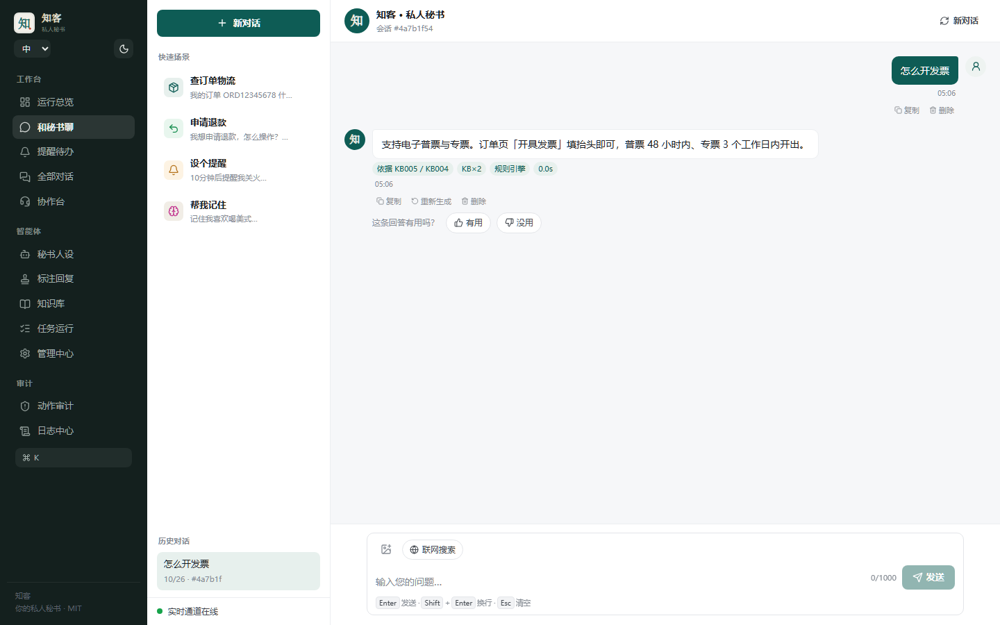
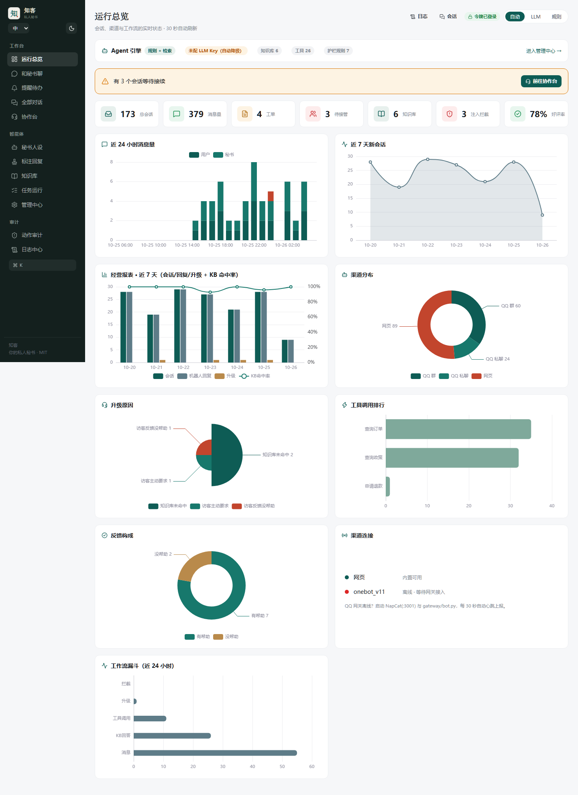
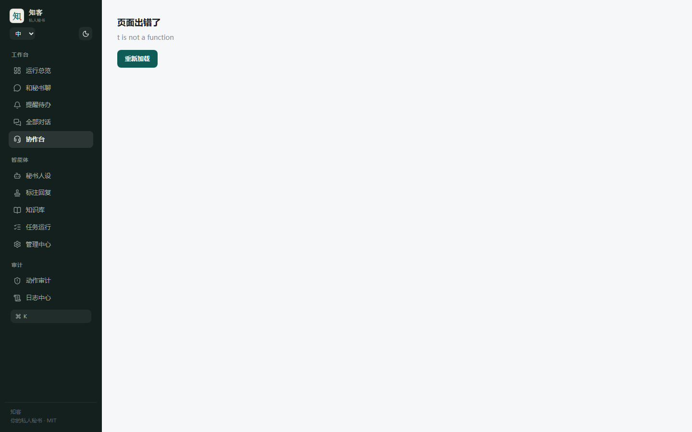
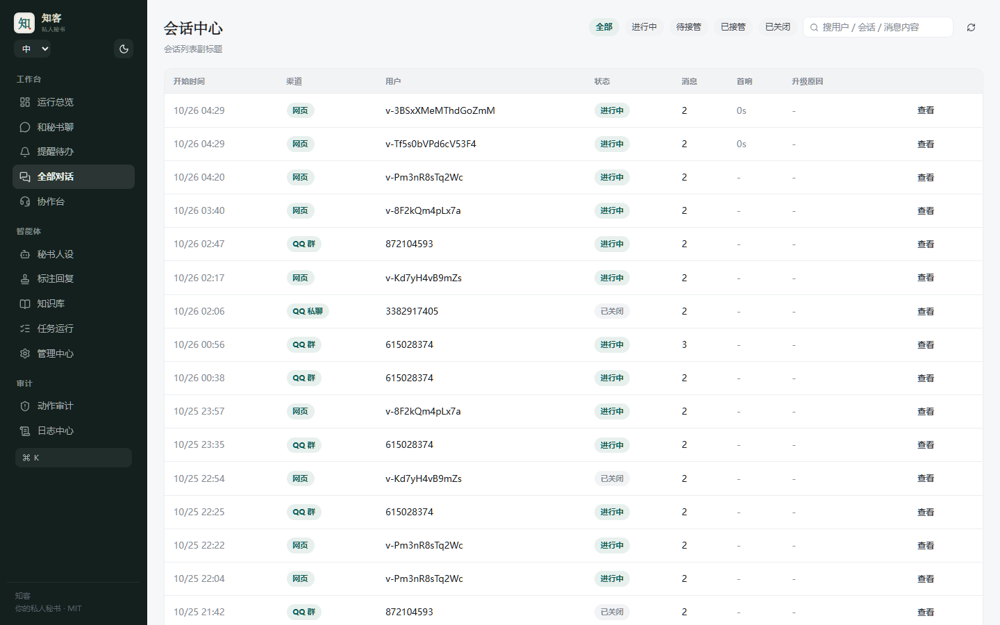
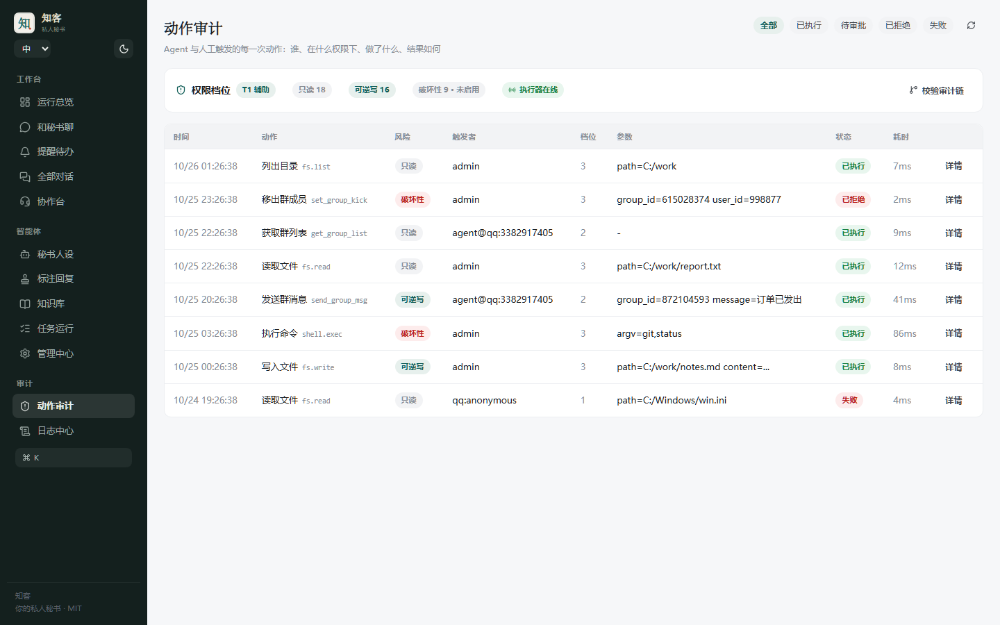
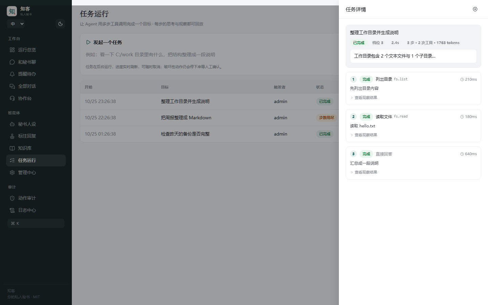
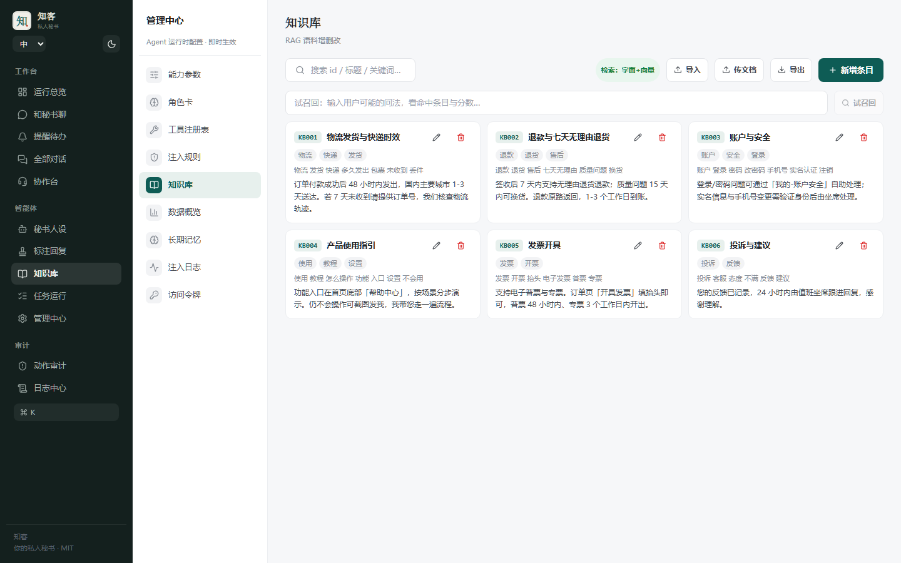
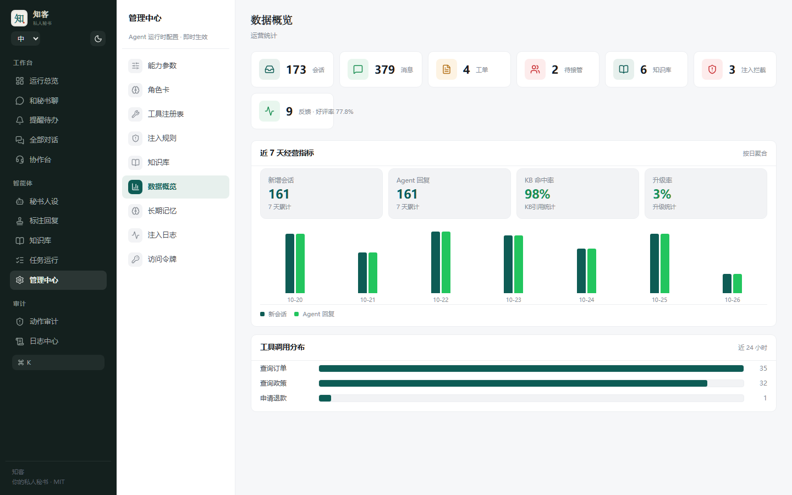
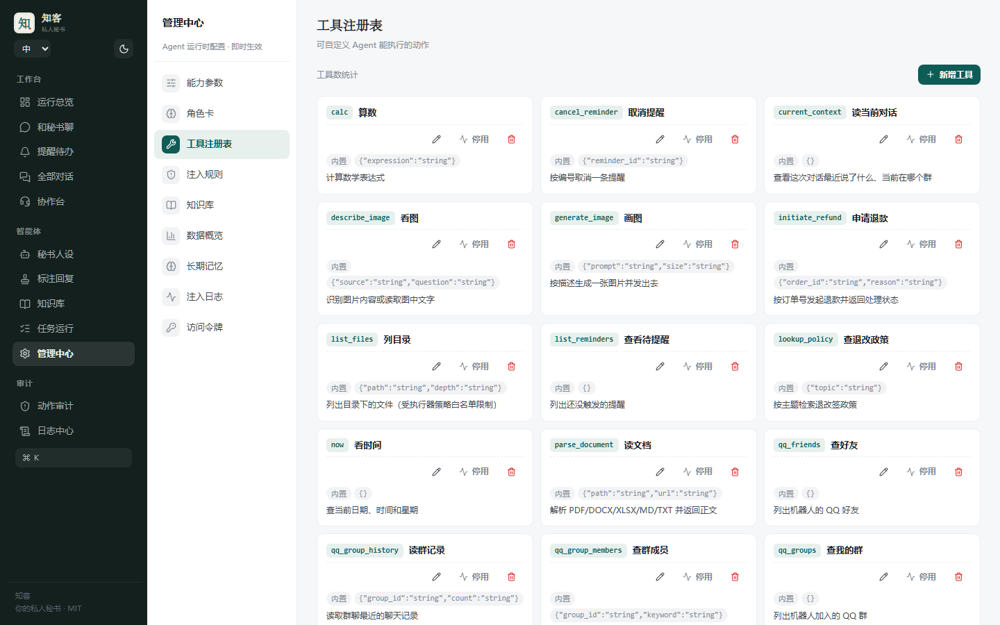
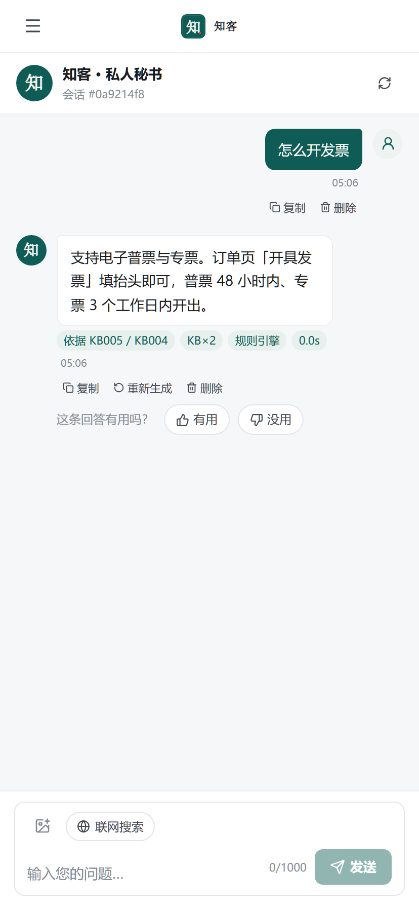

# 知客 Zhike · 在线客服 Agent

<div align="center">

**知客 · 把每一次咨询，交到该在的人手上**

QQ 群/私聊 · Web 访客 · 坐席工作台 · RAG 检索 · 工具调用 · 注入护栏

[](LICENSE)


</div>

---

重做自 `badhope/online-cs-agent`（MIT）：把「Web 演示」升级为「渠道可接、可部署、可审计」的客服 Agent 底座。QQ 走 NapCat(OneBot v11) + NoneBot2 网关，核心服务独立成 API，React 控制台单端口托管。MIT 开源。

**仓库（三平台同步）**：[GitCode](https://gitcode.com/badhope/zhike) · [Gitee](https://gitee.com/badhope/zhike) · [GitHub](https://github.com/badhope/zhike)

## 设计原则

- **降级可用**：LLM 没配/挂了 → 规则+检索照样答；核心不可达 → 网关回兜底话术，用户不面对沉默
- **三种 Agent 能力（成熟范式）**：SSE 流式打字机回复（断流自动回退整段）· 图片多模态（OpenAI 视觉内容格式，配 `USER_VISION_MODEL` 即看图）· 混合检索（可选装 BGE 中文向量模型与字面 bigram 取 max；不装自动纯字面）
- **安全默认**：注入护栏（内置规则+正则库）、ADMIN/CHANNEL 双令牌鉴权、每身份限流、静态服务防路径穿越
- **全程可审计**：会话/工具/升级/拦截全量落库，控制台可回放
- **零重依赖**：向量库可选不装、存储用 SQLite、一条命令起服务

架构与完整决策见 [docs/UPGRADE_PLAN.md](docs/UPGRADE_PLAN.md)，**部署手册见 [DEPLOY.md](DEPLOY.md)**（Docker Compose 一键脚本 + CF Tunnel 矩阵 + 验收清单）。

## 可选能力配置

| 能力 | 环境变量 | 不配置时的行为 |
|---|---|---|
| 联网搜索 | `SEARCH_PROVIDER` + `TAVILY_API_KEY` / `SERPER_API_KEY` / `SEARXNG_URL` | 前端开关提示"未配置"，对话照常 |
| 订单查询 | `ORDER_QUERY_URL`（支持 `{order_id}` 占位）、`ORDER_QUERY_TOKEN` | 返回"未接入"并转人工，**不伪造物流信息** |
| 退款申请 | `REFUND_API_URL`、`REFUND_API_TOKEN` | 同上 |
| 电脑操作 | `EXECUTOR_POLICY_PATH` + `policy.json` 的 `allow_roots` | 电脑类动作返回 503，对话不受影响 |
| Agent 自主度 | `AGENT_TIER`（0-3）、`ALLOW_TIER3`、`ALLOWED_ACTIONS_T3` | 默认 T1：只读 + 白名单内可逆写 |
| 破坏性动作 | `ACTION_L2_ENABLED=false` | 踢人/退群/删文件等一律拒绝 |

**演进路线见 [docs/PLAN-AGENT-EVOLUTION.md](docs/PLAN-AGENT-EVOLUTION.md)**：从「客服机器人」到「控 QQ 账号 + 控电脑」的分级权限 Agent（T0 只读 → T3 自主，对齐 opencode 这类本地编程 Agent 的自主度），含 16 条已复现缺陷的修法、五个阶段的任务与验收标准。

## 架构

```
QQ群/私聊 ─► NapCat ──OneBot v11──► NoneBot2 网关 ──┐
                                                    ├─► core (FastAPI)：护栏→检索→工具→LLM
Web 访客 + 坐席工作台 ──/api + /ws──────────────────┘     会话/记忆/工单/限流
```

## 截图与演示

**演示视频（真实浏览器录制，含提问 / 思考过程 / 各管理页）**：[docs/media/demo.mp4](docs/media/demo.mp4)（WebM 备选 [demo.webm](docs/media/demo.webm)）

| 访客对话（含思考过程折叠） | 运行总览 |
|---|---|
|  |  |

| 坐席工作台 | 会话中心（关键字搜索） |
|---|---|
|  |  |

| 动作审计（权限档位 + 哈希链校验） | 任务运行（后台执行 + 步骤回放） |
|---|---|
|  |  |

| 知识库（文档导入 / 试召回） | 数据概览（7 天指标） |
|---|---|
|  |  |

| 工具注册表 | 手机端访客 |
|---|---|
|  |  |

更多截图（含移动端会话中心/总览）见 [docs/screenshots](docs/screenshots)。

## 质量基线（2026-10-22 审查）

| 项 | 结果 |
|---|---|
| 后端测试 | 460 passed |
| 覆盖率 | core 行 81% / 分支 79% |
| 变异测试 | 15 个关键变异全部被杀死（抽样） |
| 在线体检 | `scripts/e2e_check.py` 18/18；`scripts/action_e2e.py` 13/13 |
| 布局审计 | 6 页 × 桌面/手机 = 12 组合全 PASS |
| lint / 类型 | ruff E9/F 类 0 错误；`tsc --noEmit` 0 错误 |
| 首屏 | echarts 主包 gzip 190KB（-66%） |

完整报告（含安全 PoC、竞品矩阵、量化看板、路线图）：[docs/AUDIT-2026-10-22.md](docs/AUDIT-2026-10-22.md)

## 快速开始

```bash
# 1. 核心服务（无 LLM Key 自动进规则+检索模式，仍可用）
python -m venv .venv
.venv/Scripts/pip install -r requirements.txt      # Linux/macOS: .venv/bin/pip
cp .env.example .env                                # 按需填 USER_LLM_* / ADMIN_TOKEN

# 2a. 单端口模式（推荐）：构建前端后由 core 直接托管
cd frontend && npm install && npm run build && cd ..
CS_AGENT_STATIC_DIR=frontend/dist python -m uvicorn core.main:app --port 8010
# → http://localhost:8010 一个地址 = 控制台 + API

# 2b. 开发模式（前端热更新，二选一）：另开终端
cd frontend && npm run dev                           # http://localhost:5173（/api 自动代理到 core）

# 3. QQ 群接入（本机）
#    a) 启动 NapCat 并在 WebUI(:6099) 里把机器人 QQ 登录，开 WebSocket 服务 :3001
#    b) 网关连 NapCat 与 core
set ONEBOT_WS_URL=ws://127.0.0.1:3001
set CORE_BASE_URL=http://127.0.0.1:8000
.venv/Scripts/python gateway/bot.py
#    群里 @机器人 说「订单什么时候发货」即可
```

Docker 一键（NapCat + core + gateway）：见 `deploy/docker-compose.yml`。

## 接入 QQ（实测路径）

```bash
# 1) 启动 NapCat（WS 服务端模式；两个端口都只绑本机）
docker run -d --name zk-napcat -e MODE=ws -e WEBUI_TOKEN=zhike-local   -p 127.0.0.1:6099:6099 -p 127.0.0.1:3001:3001 mlikiowa/napcat-docker:latest

# 2) 扫码登录：终端直接画出二维码，并轮询登录状态
python scripts/qq_login.py --timeout 300

# 3) 起网关（与服务端 CHANNEL_TOKEN 保持一致）
ONEBOT_WS_URL=ws://127.0.0.1:3001 CORE_BASE_URL=http://127.0.0.1:8010 CHANNEL_TOKEN=<同上> python gateway/bot.py
```

失败排查、稳定性机制（去重 / 同会话串行 / 并发上限 / 重试）见 **[docs/QQ-LOGIN.md](docs/QQ-LOGIN.md)**。

## 配置（环境变量）

| 变量 | 说明 | 默认 |
|---|---|---|
| `USER_LLM_API_KEY/BASE_URL/MODEL` | OpenAI 兼容端点（DeepSeek/GLM/Qwen 均可）；不配则规则模式 | 空/DeepSeek |
| `ADMIN_TOKEN` | 操作员与管理接口令牌；**生产必须设置** | 空（开发模式，启动告警） |
| `CHANNEL_TOKEN` | 渠道共享密钥：设置后 `/v1/ingest` 与网关心跳需 `X-Channel-Token` 头（网关与核心一致）；公网部署**必须设置**，防伪造消息与刷 LLM 成本 | 空（开发模式，启动告警） |
| `RATE_LIMIT_WINDOW / RATE_LIMIT_MAX` | 每身份滑动窗口限流（秒/条） | 60 / 20 |
| `SESSION_IDLE_TTL` | 渠道会话空闲多少秒后新建 | 1800 |
| `CS_AGENT_DB` | SQLite 路径 | cs_agent.db |
| `LLM_HOSTS` | 域名解析覆盖（域=IP,域=IP）：校园/内网 DNS 解析不了自定义 API 域时使用 | 空 |
| `CS_AGENT_STATIC_DIR` | 单端口模式：前端 dist 目录（空=纯 API） | 空 |
| `CS_AGENT_CORS_ORIGINS` | CORS 白名单（逗号分隔）；留空时默认只放行 `localhost:5173`（vite dev），生产需显式配置 | 空（=localhost:5173） |
| `CS_AGENT_KB` | 知识库 JSON 路径（容器里指向持久卷，否则重建镜像会丢知识库） | `core/data/kb.json` |
| `CS_AGENT_RETRIEVAL_DB` | 检索索引库路径（FTS5 / sqlite-vec 缓存） | `core/data/retrieval.db` |
| `ONEBOT_WS_URL` | NapCat 的 OneBot v11 WS 地址 | ws://127.0.0.1:3001 |
| `CORE_BASE_URL` | 网关回源核心服务地址 | http://127.0.0.1:8000 |
| `AGENT_TOKEN` | 服务间令牌：`/api/actions/execute`、`/api/agent/run` 等运维端点允许 Agent/网关调用 | 空（则只认 ADMIN/CHANNEL） |
| `CS_AGENT_DOCS` | 是否开放 `/docs` 与 `/openapi.json`（生产默认关闭） | 空（关闭） |
| `AGENT_TIER` / `ALLOW_TIER3` / `ALLOWED_ACTIONS_T3` | Agent 自主度档位（T0-T3）；T3 需双开关 | 1 / 未开 / 只读集合 |
| `ACTION_L2_ENABLED` | 是否允许破坏性动作（L2，仍需人工审批） | false |

LLM 配好后可用 `POST /api/admin/llm-test`（管理页）实测连通性与延迟。

运行时还可以在坐席工作台「设置」里改 persona / 检索 top-K / 门槛 / 工具开关 / 注入规则（存 DB，即时生效）。

## 控制台页面（frontend :5173）

| 页面 | 地址 | 能做什么 |
|---|---|---|
| 运行总览 | /dashboard | 统计卡 + ECharts 图表（消息量/会话趋势/渠道分布/升级原因/工具排行/反馈/漏斗/渠道心跳），引擎模式一键切换 |
| 会话中心 | /sessions | 全部会话（渠道/状态筛选 + 关键字搜索访客/会话/消息内容），对话回放与关闭 |
| 动作审计 | /actions | 43 个动作的权限档位、执行日志、L2 审批队列、哈希链校验 |
| 任务运行 | /runs | 发起多步任务（后台执行）、1.5s 实时进度、步骤回放、一键取消 |
| 坐席工作台 | /operator | 待接管队列 + 工单，接管/回复/关闭（WebSocket 实时），答案一键回流知识库 |
| 日志中心 | /logs | Agent 运行事件实时滚动（3 秒刷新，级别过滤，保留 1000 条） |
| 访客对话 | / | 网页访客入口；思考过程折叠、Markdown/代码高亮、逐条删除、联网搜索开关 |
| 管理中心 | /settings | 能力参数/工具注册表/注入规则/知识库/数据概览/长期记忆/注入日志 七大面板 |

## API

- `POST /v1/ingest`：渠道摄取（网关用；设置 `CHANNEL_TOKEN` 后需 `X-Channel-Token` 头）。body: `channel_type, channel_user_id, group_id?, text, display_name?, image_b64?` → `reply{text, citations, escalate, mode, tool_used}, session_id, ticket_id`
- `POST /v1/gateway/heartbeat`：网关心跳上报（30 秒一次，>90 秒无心跳显示 stale）
- 管理端：`GET /api/admin/{overview,stats,sessions,channels,logs,memory,injection-log}`（设 ADMIN_TOKEN 后需 X-Admin-Token）
- 旧版 Web API 全兼容（`/api/sessions`、`/api/operator/*`、`/api/config`、`/api/kb`、`/api/tools`、WS `/ws/{sid}`、`/ws/operator`）。

## 测试与验证

```bash
python -m pytest tests -q                    # 460 用例：管线/摄取/安全/网关映射/存储/前端兼容/统计/控制台/阶段0回归
python -m pytest tests -q --cov=core --cov-branch   # 覆盖率：行 81% / 分支 79%（core）
# 在线体检需要与服务端一致的令牌（缺令牌时脚本退出码 2 并给出提示）
ADMIN_TOKEN=xxx CHANNEL_TOKEN=yyy python scripts/e2e_check.py http://127.0.0.1:8010   # 18 项在线能力体检
CORE_BASE_URL=http://127.0.0.1:8010 python scripts/fake_napcat.py  # QQ 全链路（伪装 NapCat，含心跳）
python scripts/mock_llm.py 9099              # 本地 Mock LLM（OpenAI 兼容），配 base_url=http://127.0.0.1:9099/v1 可验通 LLM 管线
```

## 安全与合规（必读）

- **默认拒绝**：未设置 `ADMIN_TOKEN` 时所有管理/坐席接口返回 503；`/api/actions/execute` 与 `/api/agent/run` 必须先出示 ADMIN/AGENT/CHANNEL 令牌，匿名一律 401（此前匿名可执行 L0 读取动作，已修复并有回归用例）。
- **会话归属**：访客会话为 `sid + session_secret` 双因子；WS 凭据走 `Sec-WebSocket-Protocol` 子协议（query 参数会进 access log，仅保留兼容）。
- **访客身份**：`visitor_id` 由服务端随机生成；客户端自带 id 时首声明签发令牌，复用必须出示（防止填别人 id 读到对方长期记忆）。
- **消息管线防护**：注入护栏（内置规则 + 管理台正则库，表达式 ≤300 字符防回溯滥用）、每身份 + 每 IP 滑动窗口限流（SQLite 存储，多 worker 共享）、SPA 静态服务 realpath 包含性校验（防路径穿越）。
- **安全响应头**：CSP / X-Frame-Options: DENY / X-Content-Type-Options / Referrer-Policy / Permissions-Policy 全站下发；`/docs` 与 `/openapi.json` 默认关闭。
- **LLM Key**：环境变量注入时不落库；管理台保存的 Key 以 Fernet 加密存 SQLite（`ZHIKE_SECRET_KEY` 未设时从机器指纹派生，建议生产显式配置），接口回显永远掩码。
- **审计**：动作执行、审批、会话创建/关闭、配置变更写入 SHA-256 哈希链，可在「动作审计」页一键校验完整性。
- **渠道健康**：网关 30 秒心跳上报，>90 秒无心跳控制台标记 stale；`/api/debug/conn` 已收进管理令牌。
- NapCat 为**自定义非商用许可**的非官方协议端：个人/内部使用可接受，商用前必须复核其 LICENSE 原文并评估腾讯风控；合规优先场景改走 QQ 官方机器人 API（Roadmap P2）。
- 微信侧不做个人号协议；走企业微信「微信客服」/公众号客服接口（官方 API，Roadmap）。
